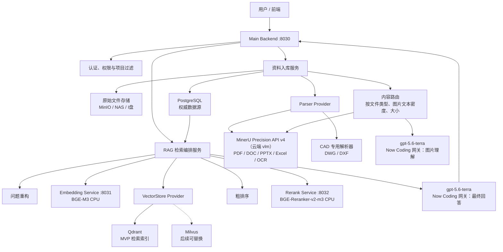
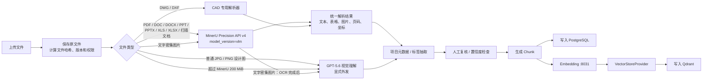

# 设计案例 RAG 系统架构说明

> 本文档用于记录当前确定的 MVP 技术架构和数据边界。

## 1. 建设目标

将历史项目资料转化为可检索、可引用的设计案例知识库，支持：

- PDF、图片、PPTX、Excel 等资料入库；
- OCR、版面、表格和图片内容解析；
- 项目元数据抽取与筛选；
- 案例、材料、空间、风格和设计做法检索；
- 基于检索证据生成带来源的设计建议。

## 2. 核心原则

1. **PostgreSQL 是权威数据源**：保存项目、文件、Chunk、元数据、权限、来源和模型版本。
2. **Qdrant 只是可重建的检索索引**：Qdrant 中的数据丢失后，可以从 PostgreSQL 重新生成。
3. **向量库访问必须通过 Provider 抽象**：业务层不直接依赖 Qdrant，后续可以切换到 Milvus。
4. **Chunk、模型版本、元数据和来源必须完整保存**：每条检索内容都能追溯到原文件、页码或图片区域。
5. **原始问题必须保留**：问题重构只能产生辅助查询，不能覆盖用户原始问题。
6. **权限过滤必须先于检索**：不能先搜出结果再让模型隐藏无权限内容。

## 3. 总体架构



## 4. 技术栈

| 层级 | 技术 | 主要职责 |
|---|---|---|
| 前端 | React / Next.js | 上传、项目管理、检索和问答界面 |
| 主后端 | Python + FastAPI | API、权限、入库、RAG 编排 |
| 数据校验 | Pydantic | 请求和响应结构校验 |
| 权威数据库 | PostgreSQL | 项目、文件、Chunk、元数据、权限、来源 |
| 原始文件存储 | MinIO / NAS / 本地磁盘 | 保存原始项目文件和解析产物 |
| 文档解析 | MinerU Precision API v4（云端 `vlm`） | PDF、DOC/DOCX、PPT/PPTX、XLS/XLSX、扫描资料的 OCR、版面和表格解析 |
| CAD 解析 | DXF / DWG 专用解析器 | 图层、图块、文字、尺寸和坐标 |
| 图片理解 | gpt-5.6-terra（Now Coding） | 空间、风格、材料、灯光、家具和设计亮点识别 |
| 元数据抽取 | gpt-5.6-terra（Now Coding）+ JSON Schema | 将解析结果转成结构化项目字段 |
| Embedding | BGE-M3，CPU 本地 | 文档和查询向量化 |
| Rerank | BGE-Reranker-v2-m3，CPU 本地 | 候选结果精排 |
| 向量库 | Qdrant | MVP 检索索引 |
| 后续向量库 | Milvus | 大规模检索或多租户场景 |
| 异步任务 | Redis + Celery / ARQ | 文件解析、批量向量化和重建索引 |
| 部署 | Docker Compose | 启动数据库、向量库和业务服务 |

## 5. 服务端口

```text
Main Backend       http://127.0.0.1:8030
Embedding Service  http://127.0.0.1:8031
Rerank Service     http://127.0.0.1:8032
```

建议接口：

```text
8030：
  POST /api/ingest
  POST /api/search
  POST /api/ask
  GET  /api/projects
  GET  /api/documents
  GET  /health

8031：
  POST /embed
  POST /embed/query
  GET  /health

8032：
  POST /rerank
  GET  /health
```

## 6. 资料入库流程



MinerU 的原始返回结果需要保存，包括：

- 原始 Markdown；
- 原始 JSON；
- 解析出的图片；
- 表格结果；
- 页码和页面坐标；
- MinerU 任务 ID；
- 解析时间和解析模式。


## 6.1 正式内容路由策略

| 输入类型或条件 | `processing_profile` | 后端记录的 `processing_route` | 处理链 |
|---|---|---|---|
| PDF、DOC/DOCX、PPT/PPTX、XLS/XLSX、扫描文档 | `auto` / `document` | `mineru_vlm` | MinerU Precision API v4，`model_version=vlm` |
| 普通 JPG/PNG/WEBP 设计图 | `auto` / `vision` | `vision` | 直接创建 GPT 视觉分析任务；无需先发送给 MinerU |
| 带大量文字的设计图 | `ocr_and_vision` | `mineru_vlm_then_vision` | MinerU vlm OCR → PostgreSQL 父子块 → 显式 GPT 图片理解 |
| 超过 MinerU Precision API 200 MiB 上限的图片 | `ocr_and_vision` | `vision` | 跳过 MinerU，路由至 GPT 视觉分析；原因写入 `route_reason` |

每个入库任务均保存 `processing_route`、`route_reason`、原文件 SHA-256、Provider、模型版本、任务 ID、解析产物路径和来源。文件上传、创建视觉任务均不外发；提交到 MinerU 或 GPT 时都必须显式确认外发。

**PPT/PPTX 大文件规范化：** 原演示文件超过 MinerU 200 MiB 限制时，先使用 LibreOffice 在本地导出 PDF；然后按页范围切分为每个不超过 200 MiB 的派生 PDF。PostgreSQL 的派生文件元数据必须记录原 PPTX 入库任务 ID、原文件 SHA-256、起止页码、转换工具/版本和清单路径。只有派生 PDF 可以进入 MinerU 的显式外发提交流程。

## 7. 简单 RAG 流程

```mermaid
flowchart LR
    A["用户问题<br/>文字 / 图片 / 上下文"] --> B["问题重构"]
    B --> C["原始问题 + 结构化条件 + 扩展检索词"]
    C --> D["权限与元数据硬过滤"]
    D --> E["Embedding :8031<br/>生成查询向量"]
    E --> F["VectorStoreProvider"]
    F --> G["Qdrant 召回候选 Chunk"]
    G --> H["粗排序"]
    H --> I["Rerank :8032<br/>精排 Top 20～30"]
    I --> J["回查 PostgreSQL<br/>获取完整 Chunk 和来源"]
    J --> K["GPT-5.6"]
    K --> L["最终回答<br/>设计建议 + 项目 + 文件 + 页码"]
```



### 检索步骤

1. 保存用户原始问题；
2. 识别意图、业态、城市、面积、风格、空间和材料等条件；
3. 复杂问题使用 GPT-5.6 生成结构化查询，简单问题使用规则提取；
4. 执行权限和元数据硬过滤；
5. 调用 BGE-M3 召回候选内容；
6. 进行粗排序；
7. 调用 BGE-Reranker-v2-m3 精排；
8. 回 PostgreSQL 获取完整 Chunk 和来源；
9. 将 Top-K 证据交给 GPT-5.6；
10. 输出带项目名称、文件、页码或图片区域的回答。

## 8. 粗排序与重排序

### 粗排序

粗排序在向量召回之后、Rerank 之前执行，主要用于快速压缩候选集：

```text
Qdrant 召回 Top 100
→ 粗排序 Top 30～50
→ Rerank Top 20～30
→ 最终使用 Top 5～10
```

粗排序可以综合：

```text
向量相似度
关键词匹配
业态匹配
城市和面积匹配
空间类型匹配
人工审核状态
来源可信度
```

粗排序由 Main Backend 完成，不需要独立模型服务。

### Rerank

Rerank 使用 BGE-Reranker-v2-m3，对以下内容逐条判断：

```text
用户问题 + 候选 Chunk
```

重点判断候选内容是否真正满足用户的业态、空间、风格、材料和实施条件。

## 9. PostgreSQL 与 Qdrant 的边界

### PostgreSQL 保存

```text
项目主数据
文件及文件版本
用户和权限
页面和图片
Chunk 原文
完整元数据
来源文件和页码
页面区域坐标
解析器名称和版本
Embedding 模型名称和版本
Embedding 向量维度
内容哈希
审核状态
查询日志和用户反馈
```

### Qdrant 保存

```text
vector_id
chunk_id
embedding vector
少量检索过滤字段
index_version
```

Qdrant 中的字段属于检索副本。若 Qdrant 与 PostgreSQL 内容不一致，以 PostgreSQL 为准，并重新构建索引。

## 10. Provider 抽象

业务层不允许直接调用 Qdrant 或 Milvus：

```python
class VectorStoreProvider:
    async def upsert(self, records):
        raise NotImplementedError

    async def search(self, vector, filters, top_k):
        raise NotImplementedError

    async def delete(self, ids):
        raise NotImplementedError

    async def rebuild(self, embedding_version):
        raise NotImplementedError
```

实现：

```text
QdrantProvider
MilvusProvider
```

配置切换：

```env
VECTOR_PROVIDER=qdrant
VECTOR_COLLECTION=design_chunks_v1
```

迁移到 Milvus 时：

```env
VECTOR_PROVIDER=milvus
VECTOR_COLLECTION=design_chunks_v1
```

迁移过程：

```text
读取 PostgreSQL 中的 Chunk 和 Embedding 记录
→ 使用 MilvusProvider 批量写入
→ 执行检索一致性校验
→ 切换 VECTOR_PROVIDER
```

## 11. 当前版本结论

```text
MinerU Precision API：负责 PDF、图片、DOC/DOCX、PPT/PPTX、XLS/XLSX 解析
CAD Parser：负责 DWG / DXF
PostgreSQL：权威数据源
Qdrant：可重建检索索引
BGE-M3：本地 CPU 召回
BGE-Reranker-v2-m3：本地 CPU 精排
gpt-5.6-terra（经 Now Coding）：问题重构、图片理解、元数据抽取和最终回答
Main Backend：统一编排所有流程
```

## 12. 第 5 步实现状态（2026-08-19）

已落地：

```text
PostgreSQL migrations
→ projects / documents / document_versions / chunks / model_versions / vector_index_records
→ VectorProvider 抽象 + QdrantProvider
→ BGE-M3 Dense + Sparse 分别召回 + RRF 融合
→ 检索前项目和角色权限过滤
→ PostgreSQL 权威回查 + 二次权限校验
→ 粗排序（Top 40）
→ BGE-Reranker-v2-m3 重排序（Top 20）
→ Grounded Evidence + Citation API
```

第 5 步不会调用 MinerU 或 gpt-5.6-terra（Now Coding）。问题重构只会在第 6 步作为 `raw query` 的附加字段接入，不能覆盖原始问题；最终回答也必须引用检索得到的 PostgreSQL 权威证据。
## 13. 当前父子分块实现（2026 年 8 月 19 日）

当前 Backend 已将单层 Chunk 调整为父子层级，仍遵循 PostgreSQL 权威、Qdrant 可重建、VectorProvider 抽象三个边界：

```text
父块（章节 / 页面组 / 表格组 / 大语义段）
  ├─ PostgreSQL chunks：chunk_level=parent，parent_chunk_id=NULL
  └─ Qdrant point：chunk_level=parent

子块（适合语义召回与 Rerank 的小文本单元）
  ├─ PostgreSQL chunks：chunk_level=child，parent_chunk_id=<父块 UUID>
  └─ Qdrant point：chunk_level=child，parent_chunk_id=<父块 UUID>
```

运行时检索顺序：

```text
权限硬过滤
→ Qdrant 仅查询 chunk_level=child 的 Dense + Sparse 索引
→ RRF 融合
→ PostgreSQL 取得子块、父块和来源
→ 子块粗排序
→ 子块 Rerank
→ 返回命中的子块 + parent_context + citation
```

父块也保存在 Qdrant，目的是使索引完整、可审计，并为后续“父块检索兜底 / 文档摘要检索”等策略保留能力；当前默认主检索明确只用子块，以保证召回精度。子块的访问范围继承父块，Backend 回查 PostgreSQL 时会再次验证父块和子块权限。迁移脚本为 `apps/backend/migrations/003_parent_child_chunks.sql`。
## 14. 第 6 步 MinerU 解析任务链（进行中）

已实现的安全边界：

```text
上传文件 ≠ 自动外发

文件上传
→ 本地归档（original）+ SHA-256
→ PostgreSQL ingestion_jobs / document_assets 创建任务
→ 由受控调用方显式执行 submit
→ MinerU 异步任务 ID 持久化
→ 轮询并归档 parser_result
→ 从 Markdown 生成父块 / 子块
→ 复用既有 PostgreSQL 权威入库 + Qdrant 可重建索引
```

`ingestion_jobs` 保留 provider、外部 task/batch ID、状态、源文件哈希、路径、请求/响应、结果路径、trace ID、错误与时间；`document_assets` 保存原始文件和解析产物的文件级证据。MinerU 返回的 Markdown 进入 `MinerUResultNormalizer` 后再产生父子 Chunk，不会跳过来源、模型、版本、索引状态等权威记录。

目前还没有外发任何真实资料，也没有把 token 写入代码或文档。MinerU Precision API v4 已采用默认的“申请批量签名上传 URL → PUT 文件 → 按 batch_id 查询结果 → 下载 full_zip_url”协议；部署时只需在 `.env` 配置 token，切换 MinerU 产品/私有网关时才覆盖 API URL。待拿到一份允许外发的脱敏 PDF 后再完成真实 API 的上传、轮询和 materialize 验证。你提供的当前 MinerU API 文档已将 XLS/XLSX 列为 Precision API 的直接输入格式，Excel 会遵循同一条显式外发审计链。

## 14. GPT 图片理解任务（2026 年 8 月 20 日）

图片理解使用 `gpt-5.6-terra`，通过 `https://nowcoding.ai/v1` 的 OpenAI 兼容网关调用。它不与本地 BGE-M3 / BGE-Reranker 共享进程或密钥。

- 只允许对已完成 MinerU `materialize` 的本地归档 PNG / JPG / JPEG / WEBP 创建视觉分析任务；
- 创建任务只写 PostgreSQL，不发送图片；
- 真正提交要求 API body 明确包含 `explicit_external_export_approved=true`；
- 每轮最多 20 张，后端与测试脚本均有硬限制；
- PostgreSQL 保存源图 SHA-256、Provider、模型版本、提示词版本、分析 JSON 和派生 `document_version`；
- 分析结果派生 1 个父块与 5 个子块，父子块均通过既有 `VectorProvider` 写入 Qdrant；检索仍只召回子块、回 PostgreSQL 带回父块上下文。

这条链路是新的第三方外发边界；它与 MinerU 授权独立，未获得本轮明确授权时不能调用提交接口。

