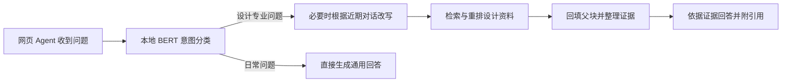

# design-rag

设计案例 RAG 系统。**PostgreSQL 是唯一权威数据源**；Qdrant 仅保存可由 PostgreSQL 重建的检索索引。所有向量库访问都必须经过 `VectorProvider` 抽象，因此后续迁移至 Milvus 不需要改动入库和检索业务流程。

## 当前完成状态

- 第 1 步：项目结构、Conda `design-rag`（Python 3.11）和 FastAPI 基础服务。
- 第 2 步：Docker Compose 项目 `design-rag`，包含 PostgreSQL 与 Qdrant。
- 第 3 步：BGE-M3 CPU 本地 Embedding 服务，端口 `8031`，输出 Dense（1024 维）+ Sparse 向量。
- 第 4 步：BGE-Reranker-v2-m3 CPU 本地 Rerank 服务，端口 `8032`。
- **第 5 步：Backend RAG 编排已实现**：父子分块权威入库、父块/子块双写 Qdrant、子块混合召回、检索前权限过滤、粗排序、重排序、父块上下文与证据/引用返回。
- **第 6 步（进行中）**：MinerU 文件归档、持久化解析任务、显式外发提交、状态轮询、结果归档及 Markdown → 父子分块标准化已实现；gpt-5.6-terra（经 Now Coding OpenAI 兼容网关）图片理解已实现为独立、显式提交的持久化任务。网页 Agent 已通过 LangGraph 接入意图分流、按需改写与证据回答。

模型权重只通过 **ModelScope** 下载；Embedding/Rerank 运行时强制 Hugging Face/Transformers 离线，不会从 Hugging Face 拉取模型权重。

## 网页 Agent 工作流

网页 Agent 使用 [LangGraph](https://github.com/langchain-ai/langgraph) 编排问答。检索节点调用 DesignRAG 的检索服务，复用父子分块、混合召回、重排和来源定位。



- 专业问题只使用本轮选中的证据。证据不足时明确提示，回答服务不可用时保留已找到的引用。
- 日常问题不调用设计知识库。网页 Agent 与面向外部调用方的受控检索 API 分别配置。详见 [Agent 检索 API](docs/agent-retrieval-api.md)。
- LangGraph 节点见 [Agent 源码](apps/backend/app/services/agent_workflow.py)。`langchain-community` 属于 RAGAS 评测依赖，网页问答通过现有模型接口和检索服务执行。

在干净克隆上验证了 FastAPI 和 Agent 依赖装配。现有 Agent 工作流与 API 安全测试 **11 项通过**。另用 8 个合成场景对比了新旧实现的输出、事件和检索参数，覆盖日常分流、证据不足、BERT 降级、改写成功与失败、引用过滤和回答服务故障。上述验证使用模拟模型及资料。

## 服务端口

| 服务 | 地址 |
| --- | --- |
| Main Backend | `127.0.0.1:8030` |
| Embedding（BGE-M3） | `127.0.0.1:8031` |
| Rerank（BGE-Reranker-v2-m3） | `127.0.0.1:8032` |
| PostgreSQL | `127.0.0.1:5432` |
| Qdrant HTTP / gRPC | `127.0.0.1:6333` / `127.0.0.1:6334` |

## 核心数据与索引边界

PostgreSQL 保存项目、文档、解析版本、Chunk 原文与哈希、完整元数据、原始来源、页码/区域定位、访问范围、审核状态、解析与模型版本、向量索引状态。`vector_index_records` 记录每一个 Chunk 在某个 Provider/Collection 中的索引副本状态。

Qdrant 保存父块和子块两类可重建索引点：`chunk_id`、`chunk_level`、`parent_chunk_id`、Dense/Sparse 向量，以及检索前硬过滤所需的最小 Payload（项目、文档、角色范围、审核/可信度）。检索结果返回后，Backend **必须重新从 PostgreSQL 获取子块正文、父块上下文和引用信息**；Qdrant 不作为事实来源。

## 父子分块（当前实现）

- **父块**：保留一个章节、页面组、表格组或语义段落的完整上下文；写入 PostgreSQL，并作为 `chunk_level=parent` 的向量点写入 Qdrant。
- **子块**：父块内更小、适合语义召回和 Rerank 的文本单元；写入 PostgreSQL，并作为 `chunk_level=child` 的向量点写入 Qdrant。
- **检索**：权限过滤后只查询子块，避免大父块稀释召回精度；命中子块后按 `parent_chunk_id` 回 PostgreSQL 取得父块上下文。
- **权限**：子块强制继承父块的 `access_scope`，并在 PostgreSQL 对子块和父块做二次校验，避免父块扩展上下文越权。
- **兼容性**：旧格式未提供 `children` 时，Backend 临时自动复制一个同内容子块；正式 MinerU 分块链路应始终显式提供父块与子块。

## 第 5 步的检索流程

```text
原始问题（保留）
  → 当前有效问题（网页 Agent 可按需消解指代）
  → 项目权限校验 + Qdrant Payload 硬过滤
  → BGE-M3 Dense + Sparse 仅召回子块 Top 100（父块也已索引，但默认不参与召回）
  → Backend 以 RRF 融合
  → PostgreSQL 回查权威子块与父块，并再次校验访问范围
  → 可解释粗排序 Top 40（按子块）
  → BGE-Reranker-v2-m3 精排 Top 6（按子块）
  → 返回 Top 8 子块证据、父块上下文和来源引用
  → 网页 Agent 调用配置的回答服务，仅依据本轮证据生成回答
```

粗排序默认权重：RRF 融合分 60%、元数据匹配 15%、审核状态 10%、来源可信度 10%、来源质量 5%。每项结果会返回该分数分解，便于调试与评估。

## 基础设施和迁移

```powershell
# 启动 / 查看 / 停止 PostgreSQL + Qdrant
.\scripts\run-infrastructure.ps1
docker compose --project-name design-rag ps
.\scripts\stop-infrastructure.ps1

# 应用 PostgreSQL schema 迁移
.\scripts\migrate.ps1
```

PostgreSQL 数据目录为 `I:\design-ai-data\postgres`。由于 Docker Desktop 下 Windows bind mount 不符合 Qdrant 的存储安全要求，Qdrant live index 使用 Docker volume `design-rag-qdrant-storage`；快照位于 `I:\design-ai-data\qdrant-snapshots`。这是安全的，因为 Qdrant 可以由 PostgreSQL 重建。

## 启动与验证

```powershell
.\scripts\run-backend.ps1
.\scripts\run-embedding.ps1
.\scripts\run-rerank.ps1

Invoke-RestMethod http://127.0.0.1:8030/health
Invoke-RestMethod http://127.0.0.1:8030/ready
conda run -n design-rag python -m pytest -q
```

`/ready` 会检测 PostgreSQL、Qdrant、Embedding、Rerank 四个依赖。

## 第 5 步 API

### 1. 将已解析且分块的内容写入权威存储并建立索引

MinerU 会在第 6 步接入；当前接口接收已解析、已分块的 JSON，便于先验证 RAG 主链路。

```powershell
$body = @{
  project = @{ external_key = 'demo-project'; name = '样例项目' }
  document = @{
    external_key = 'materials-guide-001'
    source_uri = 'demo://materials-guide-001'
    file_name = '环保板材选择说明.pdf'
    file_type = 'pdf'
    access_scope = @{ roles = @('designer') }
  }
  parser = @{ provider = 'manual'; model = 'manual-v1'; version = '1' }
  chunks = @(
    @{
      ordinal = 0
      content = '低甲醛环保板材应优先查看甲醛释放等级、第三方检测报告和封边工艺。'
      chunk_type = 'text'
      source_locator = @{ page = 1; bbox = @(10, 20, 500, 100) }
      metadata = @{ topic = 'materials'; source_quality_score = 0.95 }
      review_status = 'approved'
      source_confidence = 1.0
      children = @(
        @{
          ordinal = 0
          content = '低甲醛环保板材应优先查看甲醛释放等级和第三方检测报告。'
          source_locator = @{ page = 1; bbox = @(10, 20, 500, 100) }
          metadata = @{ topic = 'materials'; source_quality_score = 0.95 }
          review_status = 'approved'
          source_confidence = 1.0
        },
        @{
          ordinal = 1
          content = '木饰面施工还应核查封边工艺和现场通风条件。'
          source_locator = @{ page = 1; bbox = @(10, 120, 500, 180) }
          review_status = 'approved'
          source_confidence = 1.0
        }
      )
    }
  )
} | ConvertTo-Json -Depth 8

Invoke-RestMethod -Method Post `
  -Uri http://127.0.0.1:8030/api/v1/documents/ingest `
  -ContentType 'application/json; charset=utf-8' `
  -Body $body
```

成功时为 `201` 且 `index_status= indexed`。若本地模型或 Qdrant 暂不可用，权威数据仍会成功提交至 PostgreSQL，接口返回 `202` 和 `index_status=failed`；可根据 `vector_index_records` 重建索引。

### 2. 检索证据（尚不生成 LLM 答案）

把上一个接口返回的 `project_id` 填入下例。当前 MVP 的 `principal` 用于验证权限链路；接入正式认证后，必须由网关/JWT 生成，不能信任浏览器自行提交的项目与角色。

```powershell
# `/api/v1/search` is an authenticated evidence-only endpoint. Configure the token and
# project allow-list on the Design_RAG host; do not send a caller-controlled principal.
$search = @{
  query = '低甲醛环保板材如何选择'
  project_id = 'b9a4cb70-87c4-43ff-9cd2-aaec801e3925'
  evidence_top_k = 8
} | ConvertTo-Json -Depth 6

Invoke-RestMethod -Method Post `
  -Uri http://127.0.0.1:8030/api/v1/search `
  -Headers @{ Authorization = 'REPLACE_ME' } `
  -ContentType 'application/json; charset=utf-8' `
  -Body $search
```

响应保留 `query.raw` 与 `query.effective`，包含命中的 `chunk_level=child`、`parent_context`、Dense/Sparse/RRF/粗排/Rerank 分数和安全 citation。远程调用不会接收 `source_uri`、原始 `source_locator` 或父块元数据；PostgreSQL 仍完整保存这些权威溯源字段。该接口只返回 Grounded Evidence，不调用 GPT，也不调用 `/api/v1/answer`。

## 第 6 步：MinerU 任务链（当前实现）

MinerU 接入采用“**先本地归档、再显式外发**”模式：上传文件本身不会自动传到外部 API；只有调用 `submit` 接口才会发送至 MinerU。这样可让业务系统先完成资料脱敏与外发权限检查。

```text
POST 文件上传
  → I:\design-ai-data\documents\incoming\<trace_id>\original\
  → PostgreSQL：documents + ingestion_jobs + document_assets（status=created）
  → POST /submit（显式外发 MinerU）
  → POST /poll（轮询；成功后下载解析产物到 I:\design-ai-data\mineru-results\）
  → POST /materialize
  → MinerU Markdown 标准化为父块 + 子块
  → 复用现有 PostgreSQL + Qdrant 父子分块入库链
```

当前接口：

```text
POST /api/v1/ingestion-jobs                    # multipart 上传，先归档并建任务
GET  /api/v1/ingestion-jobs/{job_id}           # 查询状态、哈希、追踪号、结果位置
POST /api/v1/ingestion-jobs/{job_id}/submit    # 显式发送归档文件至 MinerU
POST /api/v1/ingestion-jobs/{job_id}/poll      # 查询 MinerU 状态；成功则下载产物
POST /api/v1/ingestion-jobs/{job_id}/materialize # 解析 Markdown → 父子块 → 入库 + 索引
```

上传接口需要 `multipart/form-data` 字段：`file`、`project_external_key`、`project_name`，可选 `document_external_key`、`access_scope_json`、`document_metadata_json`、`processing_profile`。本地归档允许 `pdf,doc,docx,ppt,pptx,xls,xlsx,png,jpg,jpeg,webp`，默认单文件上限为 512 MiB；该上限高于 MinerU Precision API 的 200 MiB，以便超限设计图仍可归档并路由给 GPT。

`processing_profile` 的取值：文档使用 `auto`（默认）或 `document`；普通设计图使用 `auto`（默认）或 `vision`；文字密集图片使用 `ocr_and_vision`。

已按 MinerU **Precision API v4** 接好两阶段流程：Backend 先创建 `file-urls/batch`，再将文件 `PUT` 到 MinerU 返回的临时签名 URL；轮询 `extract-results/batch/{batch_id}`，任务 `done` 后下载 `full_zip_url` 并从 ZIP 中提取 Markdown。临时签名上传/下载 URL 不会写入 PostgreSQL 审计 JSON。

`.env` 只需已有的 token；以下配置已有安全默认值，只有切换 MinerU 产品或私有网关时才需要覆盖：

```dotenv
MINERU_API_TOKEN=<仅放在 .env，绝不提交>
MINERU_API_BASE_URL=https://mineru.net/api/v4
MINERU_MODEL_VERSION=vlm
MINERU_PRECISION_MAX_FILE_BYTES=209715200
MINERU_ENABLE_FORMULA=true
MINERU_ENABLE_TABLE=true
MINERU_LANGUAGE=ch
MINERU_SUPPORTED_EXTENSIONS=pdf,png,jpg,jpeg,jp2,webp,gif,bmp,doc,docx,ppt,pptx,xls,xlsx,html
```

**正式文档路由已启用**：MinerU Precision API 的默认云端模型版本为 `vlm`。PDF、DOC/DOCX、PPT/PPTX、XLS/XLSX 与扫描资料走 MinerU；普通 JPG/PNG/WEBP 设计图默认直接走 GPT 视觉分析；带大量文字的设计图上传时传入 `processing_profile=ocr_and_vision`，依次执行 MinerU vlm OCR 和 GPT 视觉理解。MinerU Precision API 单文件上限为 200 MiB；超限图片自动降级为 GPT 视觉路由，并把原因保存到 PostgreSQL。


### PPT/PPTX 的本地 PDF 规范化

当 PPT/PPTX 的原文件超过 MinerU Precision API 的 200 MiB 上限时，**不能直接外发原演示文件**。先在本地导出 PDF，再按 PDF 页范围拆成不超过 200 MiB 的派生文件。每个派生文件必须通过 `document_metadata_json.derivation` 保存原始入库任务、原文件 SHA-256、PDF 页码范围、转换工具与清单路径。

安装 LibreOffice 后可运行：

```powershell
conda run -n design-rag python .\scripts\normalize-pptx-for-mineru.py `
  'I:\Design_RAG\test-data\formal-round-01\01绿城下沙\20250515-杭州绿城下沙项目深化方案.pptx' `
  --out-dir 'I:\Design_RAG\test-data\formal-round-01\01绿城下沙\derived\pptx-mineru-normalized'
```

脚本生成 `converted\` 下的原始 PDF、`mineru-segments\` 下可提交给 MinerU 的 PDF 页段，以及 `pptx-to-pdf-manifest.json`。该脚本只在本地处理，不会调用 MinerU 或 GPT。
每个文件任务在 PostgreSQL 中保存 `processing_route` 与 `route_reason`。上传和创建视觉任务不外发；以下任一操作都需要 JSON body：

```json
{ "explicit_external_export_approved": true }
```

- `POST /api/v1/ingestion-jobs/{job_id}/submit`：外发至 MinerU；只适用于 `mineru_vlm` 和 `mineru_vlm_then_vision`。
- `POST /api/v1/visual-analysis-jobs/{job_id}/submit`：外发至 GPT；适用于普通设计图，或 OCR 完成后的文字密集设计图。

DWG/DXF 仍需 CAD 专用解析器。
## GPT 图片理解（Now Coding，显式外发）

图片理解采用与 MinerU 相同的“**本地任务先创建、明确提交才外发**”原则。普通 PNG、JPG、JPEG 或 WEBP 可从已归档的原图直接创建视觉任务；`ocr_and_vision` 路由则必须先成功 `materialize` MinerU OCR 结果后创建视觉任务。API 不会读取本地目录中的任意文件，也不会在创建任务时向第三方发送图像。

```text
POST /api/v1/visual-analysis-jobs              # 创建本地视觉分析任务；不外发
GET  /api/v1/visual-analysis-jobs/{job_id}     # 查询任务、模型版本、结果和索引版本
POST /api/v1/visual-analysis-jobs/{job_id}/submit
                                                # body 必须含 explicit_external_export_approved=true
POST /api/v1/visual-analysis-jobs/batch        # 最多创建 20 个本地任务；不外发
POST /api/v1/visual-analysis-jobs/submit-batch # 最多显式外发 20 张图片
```

每一次成功分析会保存：原图 SHA-256、来源 MinerU 任务、LLM Provider / 模型版本、提示词版本、规范化 JSON 结果、错误信息（如有）和派生的文档版本。视觉结果会生成 1 个父块和 5 个子块，并经本地 BGE-M3 写入 Qdrant；因此仍满足 PostgreSQL 权威、Qdrant 可重建的边界。

当前一轮外发的硬上限是 **20 张图片**：

```dotenv
LLM_BASE_URL=https://nowcoding.ai/v1
LLM_API_KEY=<仅放在 .env，绝不提交>
LLM_MODEL_ID=gpt-5.6-terra
LLM_VISION_PROMPT_VERSION=design-image-v1
LLM_VISION_BATCH_MAX_IMAGES=20
```

准备测试（默认只创建本地任务，不外发）：

```powershell
conda run -n design-rag python .\scripts\run-vision-image-test.py `
  .\artifacts\mineru-style-test-20260819-181100.json --limit 20
```

只有在人工核对测试清单并获得外发授权后，才可加入下列两个参数执行一轮 20 张以内的测试：

```powershell
--submit --explicit-external-export-approved
```
## 关键配置

`.env` 不提交。第 5 步使用：

```dotenv
VECTOR_PROVIDER=qdrant
QDRANT_COLLECTION=design_rag_chunks_v1
RETRIEVAL_RECALL_TOP_K=100
RETRIEVAL_COARSE_TOP_K=40
RETRIEVAL_RERANK_CANDIDATE_TOP_K=8
RETRIEVAL_EVIDENCE_TOP_K=8
```

`RETRIEVAL_RERANK_CANDIDATE_TOP_K` 是送入重排模型的候选预算，
`RETRIEVAL_EVIDENCE_TOP_K` 是最终证据目标，两者独立。新配置优先于旧名称
`RETRIEVAL_RERANK_TOP_K`；仅配置旧名称时保留其取值，两者都未配置时默认 8。
粗排数量、可访问候选和每文档上限仍可能限制实际数量。
检索响应的 `pipeline` 返回 `rerank_input_count`、`evidence_count` 和
`evidence_shortfall`，用于检查实际输入和证据缺口。增加输入预算会增加 CPU 延迟，
建议用 [第一阶段评测说明](docs/rag-stage1-evaluation-20261028.md) 比较 6 / 20 / 40。

模型文件位于：

```text
I:\design-ai-data\models\bge-m3
I:\design-ai-data\models\bge-reranker-v2-m3
```

恢复模型时只使用：

```powershell
.\scripts\download-bge-m3.ps1
.\scripts\download-bge-reranker-v2-m3.ps1
```


