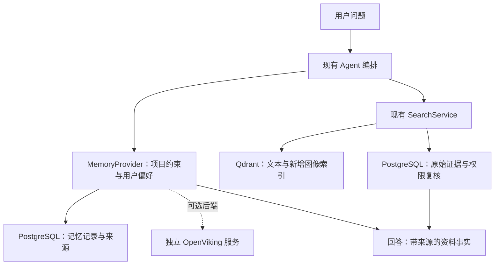

# Design_RAG 接入 OpenViking 与替代方案评估

评估日期：2026-10-13。对象：`I:\Design_RAG` 当前工作区代码及官方在线文档；不是仅依据 README。本文为架构评估和实施建议，未安装 OpenViking、修改业务代码、导入项目资料或运行外部模型评测。没有实测数据证明某个候选方案更准确。

## 1. 建议

可以接入 OpenViking。当前优先推荐继续使用 PostgreSQL + Qdrant，补齐检索质量、分层项目摘要、图像向量检索和可追溯长期记忆；将 OpenViking 保留为可替换的记忆服务候选。暂不整体迁移资料库，也不把 OpenViking 塞进现有 VectorProvider。

理由是当前系统已具备大量业务能力，而 OpenViking 与它重叠较多。OpenViking 的潜在增量主要是记忆提取、更新及统一的资源/记忆/技能访问；这些增量需要与接入、同步和运维成本一起评测。

## 2. 现有代码确认的能力与缺口

| 代码证据 | 确认事项 | 对选择方案的影响 |
| --- | --- | --- |
| `app/services/rag_service.py:103`，`app/providers/vector/qdrant_provider.py` | BGE-M3 Dense/Sparse、RRF、父子块、检索前权限过滤、PostgreSQL 回查和重排已经实现 | 已经不是基础的纯向量 RAG，不能把换框架等同于质量提升 |
| `app/services/rag_service.py:307`，`app/services/visual_analysis_service.py` | 当前检索先命中文本/图片分析文本，再关联原图或页面图 | 已有图文返回，但主链未使用原图向量进行图像相似召回；以图找图是值得单独补的能力 |
| `app/repositories/agent_repository.py`，`app/services/agent_service.py:307` | PostgreSQL 存会话消息；执行时截取当前会话的近期消息 | 持久化聊天记录与跨会话提炼偏好、项目决策、经验记忆有区别 |
| `app/services/rag_evaluation_service.py:21` | 已有 RAGAS 持久化评测流程，包含忠实度、上下文精度与召回率 | 可以复用，但还应增加人工标注的检索指标、图像相关性和记忆更新测试 |

以上路径相对于 `I:\Design_RAG\apps\backend`。README 中“最终回答尚未接入”等描述不能代表全部当前工作区实现。

### 两处应优先修正或验证的问题

1. **重排候选过早缩减。** `rag_service.py:209` 先用 `retrieval_rerank_top_k` 限制重排输入，再调用 reranker。当前配置为召回 100、粗排 40、重排输入 6、证据目标 8。因此后面申请 8 条不能恢复此前排除的候选。建议将“送入重排的数量”和“最终证据数量”拆开，在相同语料上比较 20/40 条重排输入的质量与 CPU 延迟；不能直接假定增大数量一定划算。
2. **长会话窗口错误。** `agent_repository.py:94` 的查询按时间升序取最早 100 条，`agent_service.py:307` 再取其尾部。超过 100 条后，近期对话没有被载入。用内存 SQLite 复现相同排序/截断语义：150 条消息最终窗口为 84–100，遗漏最新第 150 条。建议先倒序取最新 N 条，再恢复时间顺序，并以唯一 ID 作为同时间排序的次级键。

另有实施前置条件：`app/services/agent_workflow.py:12` 当前通过 SourcelessFileLoader 加载 Python 3.11 的旧字节码。接入记忆编排前，应恢复可读、可测试的工作流源码，避免在不可审阅的内部流程上叠加新能力。

## 3. OpenViking 能怎样接入

[Python HTTP SDK](https://github.com/volcengine/OpenViking/blob/main/sdk/python/README.md) 已提供独立的轻量 `openviking-sdk`，包括异步客户端、会话、资源与检索调用。现有 FastAPI 可以通过 HTTP 接独立 OpenViking 服务，后端无需装入完整服务运行时。

推荐增加独立的 MemoryProvider/ContextProvider 接口。现有 VectorProvider 接受预计算 Dense/Sparse 向量并返回 chunk_id；OpenViking 面向 URI、会话和上下文资源，抽象层级不同，无法仅改一个 Provider 配置完成迁移。

实施建议：

- 在 `AgentService.execute_run` 加载历史消息的位置增加长期记忆召回；恢复工作流源码后，将记忆作为单独字段交给编排器，不伪造历史消息或资料引用。
- 用户明确表达的偏好、项目决策及任务复盘，可以成为记忆候选；模型对效果图的猜测不能自动升级为已确认的项目事实。
- PostgreSQL 保存记忆候选、已确认记录、来源消息 ID、项目/用户范围、版本、撤销及失效时间。OpenViking 负责候选提取和辅助检索时，返回结果仍须回查 PostgreSQL；候选提取结果需落库后才能进入正式上下文。
- 第一轮只试记忆。若之后试资源管理，再将脱敏的派生 Markdown/项目摘要单向同步到 OpenViking，并记录 document_id、version_id、chunk_id、SHA-256 与 URI 的映射。更新、删除、撤权通过 outbox 重试与版本检查传播；旧版本必须可被拒绝。
- 外部服务故障时回退到现有检索与会话窗口；记忆处理放后台，不把每次提取放进问答关键路径。

### 兼容性与成本

OpenViking [存储文档](https://docs.openviking.ai/en/concepts/05-storage) 描述的是自身内容存储与向量索引，列出的向量后端包括 local/http/volcengine。不能假定它能直接复用现有 Qdrant collection。接入会多出同步、备份和运维边界。

现有本地 EmbeddingClient 调用自定义 `/embed` 接口；OpenViking 的模型配置并不因此自动兼容，需要实现协议适配或使用独立模型服务。即使都输出 1024 维，也必须确认模型、修订版本、归一化和输入语义一致。仅用文本 embedding 时，不能得到真正的图像查询能力。[模型配置](https://github.com/volcengine/OpenViking/blob/main/docs/en/guides/01-configuration.md)

OpenViking [ACL](https://docs.openviking.ai/en/concepts/15-acl) 默认关闭，启用后共享资源仍有根目录继承规则。项目范围参数不等于授权；需要服务端身份映射、受限项目根目录、检索前限制和 PostgreSQL 二次校验。当前匿名客户端身份也不应自动变成跨设备或全团队的共享记忆身份。

最新 [检索机制文档](https://docs.openviking.ai/en/concepts/07-retrieval) 说明：每个查询进行全局向量搜索，目录、类型和权限限定范围，重排可选；默认不递归遍历目录。此前关于目录递归检索的介绍不应作为当前能力保证。L0/L1/L2 分层摘要仍有参考价值，但效果需要实测。

自部署可通过独立 HTTP 服务接入；当前机器已使用 Docker，可优先评估隔离容器，实际版本与镜像需在试点时固定。先用合成记忆数据完成链路，再决定是否处理真实项目数据。[部署文档](https://docs.openviking.ai/en/guides/03-deployment)

## 4. 替代路线比较

以下“优先级”是基于当前代码与业务目标的工程判断，不是测得的产品排名。

| 路线 | 适合解决什么 | 新增负担 | 本项目建议 |
| --- | --- | --- | --- |
| 增强现有 PostgreSQL + Qdrant | 精确证据检索、图文案例、来源与权限；同时补项目记忆 | 维护少量新表、后台任务与检索分支 | 第一优先；复用现有数据和业务约束 |
| OpenViking 作为独立记忆/上下文服务 | 多会话、多工具共享经验，统一资源与技能访问 | 新服务、模型调用、身份映射、双系统同步 | 第二优先；以可回退的小试点验证 |
| Mem0 作为记忆组件 | 主要需求是用户偏好和对话记忆 | 仍需与权威存储、权限和记忆生命周期对接 | 与 OpenViking 竞争记忆后端，不另起一套资料检索系统；参考[官方仓库](https://github.com/mem0ai/mem0) |
| LightRAG 作为关系检索实验 | 项目—空间—材料—供应商—工艺之间的跨文档关系问题 | 实体关系提取、消歧和图谱维护 | 有明确关系类问题集后再试；参考[官方仓库](https://github.com/HKUDS/LightRAG) |

Mem0 官方仓库说明其为记忆层，开源许可为 Apache-2.0；OpenViking 当前主项目为 AGPL-3.0。这里仅记录许可差异，不推导具体部署的法律结论。两者的官方记忆基准都不能直接证明对设计案例检索有效。

LightRAG 支持图谱、文本块结合检索以及 PostgreSQL 后端，但它的实体关系抽取也是新处理链。现有系统若重点是“找这页原文/找这张空间图”，收益需要先由问题集证明。

## 5. 推荐建设顺序

1. **修正已有链路并建立基线。** 修复长会话窗口，恢复工作流可读源码；拆分重排输入与输出数量。保留旧配置作为对照。
2. **项目与文档分层摘要。** 为项目、文档建立有来源的摘要与目录节点；宽泛问题先召回摘要帮助选范围，精确问题仍允许直接检索原始块，避免摘要路由丢失细节。
3. **增加原图检索。** 保留 BGE-M3 文本索引，另建图像 collection（或经版本验证后的 named vector）；采用图文共同 embedding 的候选模型，融合两路结果后回查来源。Qwen3-VL-Embedding-2B 可列为候选，是否适合本机要测显存、速度与案例相关性。[Qwen 官方仓库](https://github.com/QwenLM/Qwen3-VL-Embedding) / [Qdrant 向量文档](https://qdrant.tech/documentation/manage-data/vectors/)
4. **建立可追溯项目记忆。** 至少区分用户偏好、项目决定和可复用经验，记录作用范围及失效条件。例如“本项目不采用亮面石材”不能泛化成所有项目的永久偏好。
5. **比较记忆后端。** 在相同接口下比较原生 PostgreSQL/Qdrant 记忆、OpenViking，必要时再加入 Mem0。只有收益足够时才扩大接入。

## 6. 如何判定值得接入

建议分开做两类实验，避免把“记忆增强”与“资料重建索引”的收益混为一谈：

- 检索实验：原系统、修正重排后的系统、增加摘要的系统、增加图像召回的系统。固定语料与解析版本，标注目标页/块/图；比较 Recall@K、排序质量、引用定位、图像相关性、p50/p95 延迟及成本。
- 记忆实验：在同一资料检索底座上比较无长期记忆、原生记忆、OpenViking 记忆；使用合成跨会话任务测召回、修改、失效、遗忘、项目隔离和偏好误用。模型配置不同时单独报告，避免将模型差异误认为框架收益。

首轮建议 20–30 道真实检索题，另加独立的记忆与权限用例。当前评测服务默认每轮最多 30 例，可以分套运行。已有 RAGAS 指标可作辅助，不能代替人工核对图片和来源。接入验收必须包含删除/撤权、旧索引、超时回退和重试幂等场景。

只有试验显示明确的任务收益、可接受的延迟/费用和正确的数据边界后，才建议将 OpenViking 变成正式依赖。当前结论是“技术上可接、先做小试点”，不是“已经接通”或“已验证优于现有系统”。
